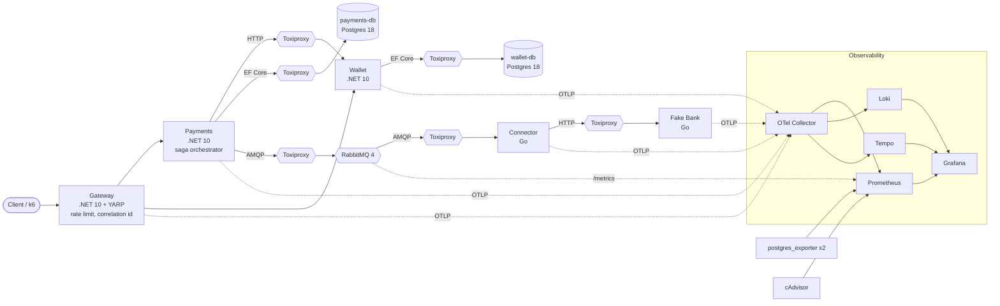
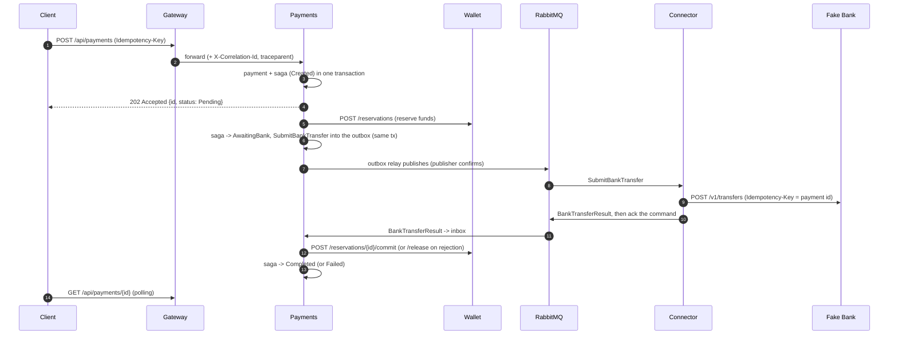
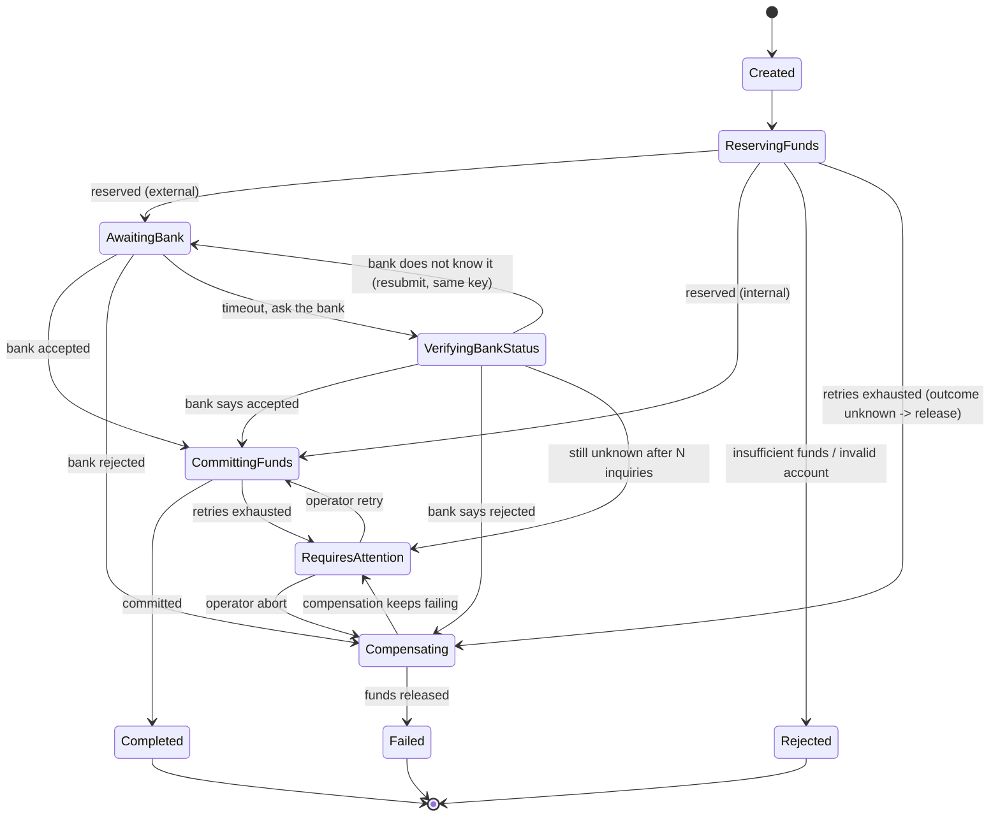

# PaymentLab

A local, Docker-based **payment system lab for practising production incident diagnosis**: several
services, an orchestrated saga, RabbitMQ, an external (fake) bank, two Postgres databases, realistic data
volume, load generation and full observability (metrics, logs, traces in Grafana).

The idea: start the lab, let the game master break something (`./lab.ps1 incident`), and find the root
cause the way you would in production – from the symptom to metrics, from metrics to traces, from traces
to logs and code – then fix it yourself and write a post-mortem.

> **AI assistance.** The lab scaffold (services, infrastructure, dashboards, scripts and the incident
> scenarios) was built with the help of an AI coding assistant (Claude Code). The fixes and post-mortems
> listed at the end of this file are my own work.

---

## Architecture



| Component | Tech | Responsibility |
|---|---|---|
| `gateway` | .NET 10, YARP | Single entry point (`/api/payments/**`, `/api/accounts/**`), per-client token-bucket rate limiting, `X-Correlation-Id` |
| `payments` | .NET 10, EF Core + Npgsql, RabbitMQ.Client | Payment API with `Idempotency-Key`, hand-written orchestrated saga, transactional outbox + inbox, operator endpoints |
| `wallet` | .NET 10, EF Core + Npgsql | Accounts, balances, reservations (holds) and ledger; reserve / commit / release are idempotent per payment |
| `connector` | Go, amqp091-go | Consumes bank commands (manual acks, prefetch), calls the bank, publishes results with publisher confirms, retries through a delay queue, dead-letter queues |
| `fakebank` | Go | Simulated bank with configurable latency and failure behaviour (`/admin/config`) |
| `rabbitmq` | RabbitMQ 4.4 + management + Prometheus plugin | Quorum queues, DLX, delay queues |
| `payments-db`, `wallet-db` | Postgres 18 | One database per service, `pg_stat_statements` on |
| `toxiproxy` | Shopify Toxiproxy | Every hop to a dependency goes through it, so latency / resets / timeouts can be injected without code changes |
| observability | OTel Collector, Prometheus, Loki, Tempo, Grafana, postgres_exporter, cAdvisor | Metrics, logs and traces, provisioned dashboards |
| `k6` | grafana/k6 (on demand) | Load generation, metrics go to Prometheus as well |

### One payment, end to end



Internal payments (between two wallet accounts) skip the bank: reserve → commit (debit + credit in one
database transaction). The whole payment – HTTP calls, database statements, both RabbitMQ hops and the bank
call – is **one trace** in Tempo.

### The saga

The state machine is in one file: `src/dotnet/Payments/Saga/PaymentSaga.cs` (states, step list,
transition rules). Saga state is persisted in `payment_sagas` (current step, attempts, timeouts, lease),
every transition is appended to `payment_history`, so a restarted service resumes in-flight sagas.



Step kinds: **ReserveFunds** is compensatable (release), **SubmitToBank** is the pivot (after the bank
accepted there is no way back), **CommitFunds** is retriable (retried until it succeeds or is escalated).
Client-visible status: `Pending`, `Completed`, `Failed`, `Rejected`, `UnderReview` (= `RequiresAttention`).

Operator endpoints (Payments, not routed through the gateway):
`GET /admin/sagas?state=RequiresAttention`, `GET /admin/sagas/summary`, `GET /admin/sagas/{id}`,
`POST /admin/sagas/{id}/retry`, `POST /admin/sagas/{id}/abort`.

---

## Prerequisites

- **Docker Desktop** with the WSL2 backend, running. The stack's limits add up to ≈ 6.7 GB (including k6
  while a load test runs). WSL2 gets 50 % of host RAM by default (8 GB on a 16 GB machine) – that is enough;
  for the `large` seed more headroom helps:
  ```ini
  # %UserProfile%\.wslconfig   (then: wsl --shutdown, restart Docker Desktop)
  [wsl2]
  memory=10GB
  ```
- **PowerShell 7** is recommended (`winget install Microsoft.PowerShell`); the scripts also run in
  Windows PowerShell 5.1.
- Nothing else: services are built inside Docker; k6 and psql run in containers. (Optional: .NET 10 SDK and
  Go 1.26+ for working on the code; Python 3 to regenerate dashboards.)

## Quick start

```powershell
git clone <repo> PaymentLab; cd PaymentLab
./lab.ps1 up          # build and start everything (first build takes a few minutes)
./lab.ps1 smoke       # 10 payments end to end, checks final states and balances
./lab.ps1 seed medium # optional: 1 M historical payments
./lab.ps1 load steady # background traffic for 5 minutes (20 req/s)
```

Open Grafana at http://localhost:3000 → *Dashboards → PaymentLab → Overview*.

## Lab commands

| Command | What it does |
|---|---|
| `./lab.ps1 up` | Build and start everything, wait until all services are ready, print the URLs |
| `./lab.ps1 down` | Stop everything (data is kept) |
| `./lab.ps1 reset [-Force]` | Stop, **delete all data** (volumes) and start fresh |
| `./lab.ps1 status` | Containers, readiness of every service, CPU / memory per container |
| `./lab.ps1 logs <service>` | Follow the logs of one service (`payments`, `wallet`, `connector`, `payments-db`, …) |
| `./lab.ps1 smoke` | End-to-end smoke test (exit code 0 = passed) |
| `./lab.ps1 seed small\|medium\|large [-Force]` | Replace the database contents with synthetic history (see below) |
| `./lab.ps1 load steady\|ramp\|spike\|soak [rate] [duration]` | Run a k6 load test, e.g. `./lab.ps1 load ramp 150 5m` |
| `./lab.ps1 incident [-Id N \| -Difficulty easy\|medium\|hard]` | Start an incident (see [Practising](#practising-incidents)); `--id N` / `--difficulty X` also work |
| `./lab.ps1 hint` | One more hint for the open incident (max 3) |
| `./lab.ps1 reveal` | Root cause and explanation of the open incident |
| `./lab.ps1 resolve` | Remove the fault, restore the system and run the smoke test |
| `./lab.ps1 urls` | Print the URLs |

Every command accepts `-EnvFile <file>` to layer an extra env file over `.env` (see
[Resource limits](#resource-limits)).

## URLs

| What | URL |
|---|---|
| **Grafana** | http://localhost:3000 – opens without login (viewer + Explore); sign in as `admin` / `admin` to edit dashboards |
| Gateway (public API) | http://localhost:8080 (`/api/payments`, `/api/accounts`) |
| Payments Swagger | http://localhost:8081/swagger |
| Wallet Swagger | http://localhost:8082/swagger |
| Fake Bank config | http://localhost:8090/admin/config |
| RabbitMQ management | http://localhost:15672 (`lab` / `lab`) |
| Prometheus | http://localhost:9090 |
| Toxiproxy API | http://localhost:8474/proxies |
| cAdvisor | http://localhost:8088 |
| Loki / Tempo APIs | http://localhost:3100, http://localhost:3200 |
| Postgres | payments: `localhost:5432`, wallet: `localhost:5433` (user = password = database name) |
| OTLP (collector) | `localhost:4317` (gRPC), `localhost:4318` (HTTP) |

`psql` without installing it: `docker compose exec payments-db psql -U payments -d payments`.

## Dashboards

All provisioned automatically in the *PaymentLab* folder (generated by `scripts/dashboards/generate.py`;
`python scripts/dashboards/check.py` runs every panel query against the running stack).

| Dashboard | Use it for |
|---|---|
| **Overview** | Start here: payments created / finished, in-flight by saga state, end-to-end time, RED metrics of every service, queue depth, DB sessions, container saturation, latest warnings/errors, traces with errors |
| Gateway | Traffic by route and status, latency, rate-limiter decisions, upstream latency, runtime |
| Payments | Payment API, saga (step durations, outcomes, retries, transitions, claim query), outbox / inbox, calls to Wallet, Npgsql pool, runtime, slow / failed traces, logs |
| Wallet | Reserve / commit / release outcomes and latency, API, Npgsql pool, runtime, logs |
| Connector | Deliveries, how messages were settled, bank call outcomes and latency, publishing, Go runtime, logs |
| Fake Bank | The bank's own view: transfers by result, responses, latency |
| RabbitMQ | Per-queue ready / unacked / consumers / rates / redeliveries, DLQs, broker memory and alarms |
| Postgres | Per database: sessions by application and state, waits, blocked sessions, oldest transaction, locks, TPS, tables (scans, sizes, dead rows), top statements from `pg_stat_statements` |
| Containers | CPU vs. limit, throttling, memory vs. limit, OOM kills, restarts, network |
| Load (k6) | What the load generator sees (latency, failures, retries, E2E time, dropped iterations) next to the system |

**Logs ↔ traces.** Logs are in Loki (`{service_name="payments"}`), every line carries `trace_id`; in Grafana
a log line's details have an *Open trace* link. From a trace in Tempo, *Logs for this span/trace* shows the
logs of every service that took part. Latency panels show exemplars (dots) that open the trace.

## Data and load

**Seed** (`./lab.ps1 seed <scale>`): replaces both databases with consistent synthetic history (balances
equal the sum of the ledger, every completed payment has its debit/credit) using `generate_series` inside
Postgres. Services are stopped while seeding and restarted afterwards.

| Scale | Accounts | Payments | History rows | Time (i7, Docker Desktop) | DB size |
|---|---|---|---|---|---|
| `small` | 10 k | 10 k | ~53 k | seconds | small |
| `medium` | 100 k | 1 M | ~5.3 M | ~1 min | ~1.7 GB |
| `large` | 500 k | 4 M | ~21 M | ~5 min | ~6.8 GB |

**Load** (`./lab.ps1 load <scenario> [rate] [duration]`): k6 in Docker against the gateway. Client
behaviour: 65 % create a payment (70 % external / 30 % internal) and poll it until it is final, 20 % read an
account, 15 % list an account's payments; 5 s client timeout; retries on timeout / 429 / 5xx with the
**same** `Idempotency-Key` and backoff; 20 different client ids. After a seed it uses (a sample of) the seeded
accounts, otherwise it creates its own. Summaries are saved to `load/results/`.

| Scenario | Shape | Default |
|---|---|---|
| `steady` | constant arrival rate | 20/s for 5m |
| `ramp` | 5/s → rate over duration, stops when error / latency thresholds break | 300/s over 10m |
| `spike` | base rate 1 min, 10× for 30 s, back to base for *duration* | 20/s, 2m |
| `soak` | constant moderate rate | 15/s for 30m |

With the default limits one Payments instance (1 CPU) completes roughly 40–65 payments/s including client
polling, so `steady`/`soak` defaults are comfortably below and `ramp`/`spike` go above it on purpose. k6 exits
with "thresholds crossed" when the system could not keep up – that is a result, not a script error.

## Resource limits

Every container has CPU and memory limits from `.env` (`<SERVICE>_MEM`, `<SERVICE>_CPUS`), plus tuning knobs
(DB pool sizes, prefetch, rate limit, Postgres `shared_buffers`, fake bank defaults). To run with tighter
limits without editing `.env`, layer a profile:

```powershell
./lab.ps1 up -EnvFile limits.tight.env     # example profile with smaller limits
./lab.ps1 status                           # MEM USAGE / LIMIT per container
```

| Group | Memory |
|---|---|
| Services (gateway, payments, wallet, connector, fakebank) | 256 + 384 + 384 + 128 + 128 MB |
| Data (payments-db, wallet-db, rabbitmq, toxiproxy) | 1024 + 768 + 512 + 128 MB |
| Observability (collector, Prometheus, Loki, Tempo, Grafana, 2× exporter, cAdvisor) | 256 + 512 + 384 + 512 + 384 + 128 + 192 MB |
| k6 (only while a load test runs) | 768 MB |
| **Total** | **≈ 6.7 GB** |

## Practising incidents

```powershell
./lab.ps1 incident                    # random scenario
./lab.ps1 incident -Difficulty easy   # or: --difficulty easy
./lab.ps1 incident -Id 4              # or: --id 4
```

The game master starts simulated customer traffic, injects a fault and prints an **incident ticket** –
what support, a customer or an alert would report: symptoms, time, impact, nothing about the cause. Then:

1. Investigate with Grafana, Tempo, Loki, the RabbitMQ UI, `psql`, the code. See
   [docs/INVESTIGATION_GUIDE.md](docs/INVESTIGATION_GUIDE.md).
2. `./lab.ps1 hint` if you are stuck (each call is more specific, max 3).
3. `./lab.ps1 reveal` shows the root cause.
4. `./lab.ps1 resolve` removes the fault, resumes payments that were parked for review, and runs the smoke
   test. Some faults only *expose* a problem in the code – after `resolve` the system is healthy again, but
   the real fix is yours to make (then reproduce the incident and show it no longer happens).
5. Write a post-mortem from [docs/postmortems/TEMPLATE.md](docs/postmortems/TEMPLATE.md).

Only one incident can be open at a time. The incident state is kept in `chaos/.state/` (gitignored).
**Spoilers:** `chaos/` and `docs/spoilers/` contain the answers – don't open them while practising.

## Extending the system

**A new saga step** (e.g. a fraud / limits check before the bank):

1. Implement `ISagaStep` in `src/dotnet/Payments/Saga/Steps/` (`Name`, `State`, `Kind`, `MaxAttempts`,
   `AppliesTo`, `ExecuteAsync`, optionally `OnMessageAsync` for an asynchronous reply, `OnTimeoutAsync`,
   `CompensateAsync`). A check that only decides would be `Compensatable` with a no-op compensation and
   return `Reject(reason)` to decline.
2. Add its in-progress state to `SagaState` and insert the step into `PaymentSagaDefinition.Steps` at the
   right position (e.g. after `reserveFunds`, before `submitToBank`); register it in `Program.cs`.
3. If it talks to another service over RabbitMQ, add the message contracts to
   `Shared/PaymentLab.Contracts/Messaging.cs`, send with `ctx.Send(...)` (goes through the outbox) and return
   `Wait(timeout)`; replies arrive through the inbox and are passed to `OnMessageAsync`.
4. Update the state diagram above and in `docs/PLAN.md`.

Persistence, the worker, timeouts, retries, compensation order and the operator endpoints need no changes.

**A choreography version** of the same flow: instead of the orchestrator, each service reacts to events and
publishes its own (`PaymentRequested` → Wallet reserves and publishes `FundsReserved` → Connector submits and
publishes `BankTransferAccepted/Rejected` → Wallet commits/releases → Payments only projects the status).
The building blocks are already here: the topic exchange `payments.events`, outbox/inbox, idempotent wallet
operations, trace propagation through messages. A good way to compare: build it next to the orchestrated
flow (e.g. `type: "Choreographed"` or a separate service) and look at the same incidents in both.

## Windows / Docker Desktop notes

- **Docker Hub rate limit (HTTP 429 "toomanyrequests")** while pulling base images: run `docker login`, or
  pull from Google's mirror and re-tag, e.g.
  `docker pull mirror.gcr.io/library/postgres:18-alpine; docker tag mirror.gcr.io/library/postgres:18-alpine postgres:18-alpine`
  (same for `golang:1.27-alpine`, `alpine:3.23`, `rabbitmq:4.4-management-alpine`).
- **cAdvisor** works on Docker Desktop (WSL2) here; it runs privileged and reads the Linux VM's cgroups. If it
  does not start on your machine, the Containers dashboard stays empty – use `./lab.ps1 status`
  (`docker stats`) instead; everything else is unaffected.
- **RabbitMQ memory**: RabbitMQ does not detect the container limit, so `RABBITMQ_MEM` is also passed to it
  (its memory alarm fires at 60 % of the container limit). Keep the `MB` unit in that variable.
- **Line endings**: `.gitattributes` keeps LF for files used inside containers (shell, SQL, YAML, Go, C#) and
  CRLF for `*.ps1`. If you edit with a tool that rewrites line endings, `git add --renormalize .`.
- **PowerShell 5.1**: works, but output of `docker` can look different; PowerShell 7 is recommended.
- **Grafana 13** allows only *Viewer* for anonymous users; Explore is enabled for viewers, editing needs the
  `admin` login.
- k6 sends its metrics over OTLP (its Prometheus remote-write output is deprecated in k6 2.x).

## Project structure

```
lab.ps1                 control script (up, down, reset, status, logs, smoke, seed, load, incident, ...)
docker-compose.yml      all services; limits and versions from .env
.env, limits.tight.env  versions, resource limits, tuning
src/dotnet/             Gateway, Payments, Wallet, Shared (service defaults, contracts)
src/go/                 connector, fakebank
infra/                  otel-collector, prometheus, loki, tempo, grafana (provisioning + dashboards),
                        postgres (init), postgres-exporter (queries), rabbitmq, toxiproxy
seed/                   SQL for ./lab.ps1 seed
load/k6/                k6 scenarios (results in load/results, gitignored)
scripts/                smoke test, dashboard generator and checker
docs/                   PLAN.md, INVESTIGATION_GUIDE.md, postmortems/
chaos/, docs/spoilers/  incident scenarios and answers (spoilers)
```

---

## My fixes and post-mortems

<!-- List the problems you found and fixed yourself: date, incident, root cause, the fix (commit), link to the post-mortem in docs/postmortems/. -->

| Date | Incident / symptom | Root cause | Fix | Post-mortem |
|---|---|---|---|---|
| | | | | |
