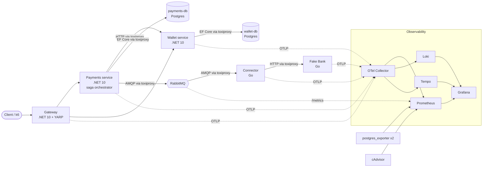
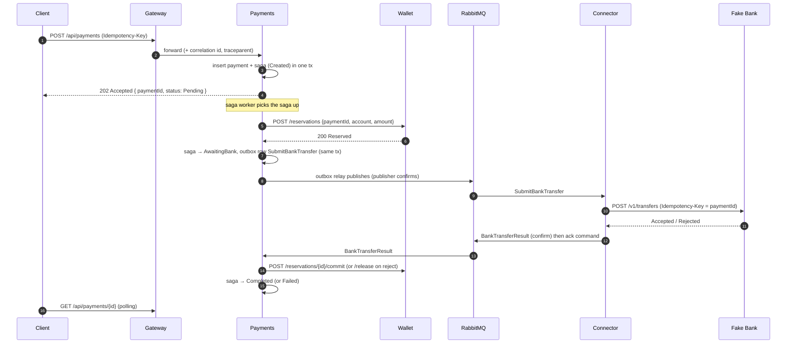
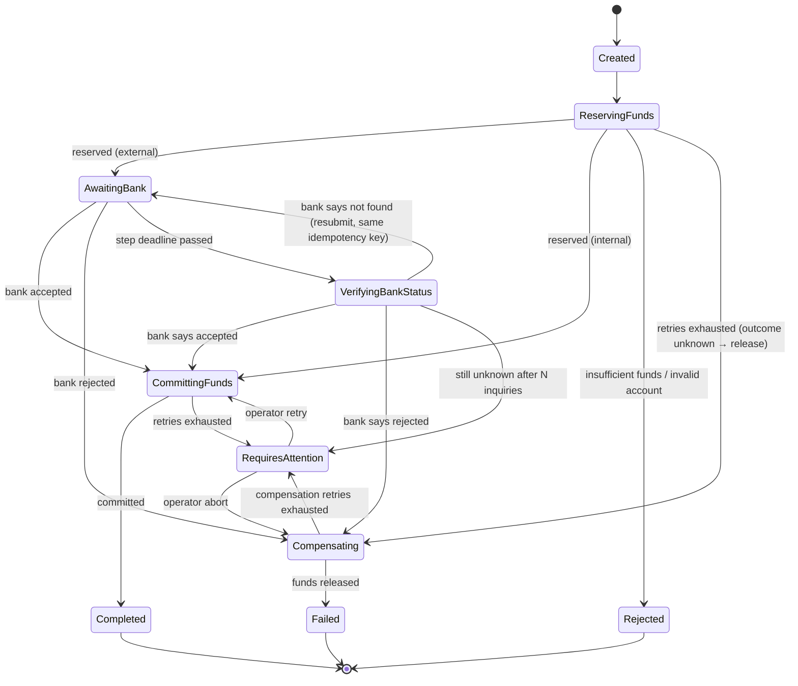

# PaymentLab – Build Plan

> Status: **draft, waiting for approval** (Step 0).
> This plan deliberately does not describe the lab's deliberate weaknesses or fault scenarios.

## 1. Goal

A local, Docker-based payment system that behaves like a small production system: several services,
async messaging, an external bank dependency, full observability, realistic data volume and load.
It is used to practise diagnosing incidents (symptom → metrics → traces → logs → root cause → fix).

## 2. Architecture



| Component | Tech | Notes |
|---|---|---|
| `gateway` | .NET 10, YARP | Routing to Payments and Wallet, per-client token-bucket rate limiting (`X-Client-Id`, fallback IP), `X-Correlation-Id` generation/propagation, OTel. |
| `payments` | .NET 10, EF Core + Npgsql, RabbitMQ.Client | Payment API, idempotency, saga orchestrator (hand-written), transactional outbox, bank-result consumer, operator endpoints. |
| `wallet` | .NET 10, EF Core + Npgsql | Accounts, balances, reservations (holds), ledger. Reserve / commit / release are idempotent per `paymentId`. |
| `connector` | Go, amqp091-go, otel-go | Consumes bank commands with manual acks and configurable prefetch, calls Fake Bank, publishes results with publisher confirms, retry via delay queue, dead-letter queue. |
| `fakebank` | Go | Simulated bank: `POST /v1/transfers` (Idempotency-Key), `GET /v1/transfers/{key}`, `POST /admin/config` for latency, jitter, reject rate, error rate, timeouts. |
| `payments-db`, `wallet-db` | Postgres (current stable major, verified at build time) | One container per service. `pg_stat_statements` on, slow-query logging on. |
| `rabbitmq` | RabbitMQ 4.x `-management` image | Management UI + built-in Prometheus plugin (port 15692). |
| `toxiproxy` | Shopify Toxiproxy | Proxies for both DBs, RabbitMQ, Wallet HTTP and Fake Bank. All services connect through it. |
| `otel-collector` | OpenTelemetry Collector (contrib) | Receives OTLP from all services; exports traces → Tempo, metrics → Prometheus, logs → Loki (OTLP). |
| `prometheus`, `loki`, `tempo`, `grafana` | current stable images | Grafana datasources and dashboards provisioned from files. Loki ↔ Tempo linked via `trace_id`. |
| `postgres-exporter` (x2) | prometheus-community | Connections, locks, long transactions, `pg_stat_statements`, table sizes. |
| `cadvisor` | cAdvisor | Container CPU / memory / throttling. If it does not work on Docker Desktop, the fallback is documented in the README. |
| `k6` | `grafana/k6` image, on demand | Not running permanently; started by `lab.ps1 load`. |

All exact image tags and NuGet / Go module versions are checked against the registries in Phase 1 and pinned.

## 3. Payment flow

Two payment types:

- **External** – from an internal wallet account to an external IBAN, goes through the bank.
- **Internal** – between two internal wallet accounts, no bank step.



Internal payments skip steps 8–13: after funds are reserved the saga goes straight to commit, and the
Wallet commit debits the source and credits the destination account in a single DB transaction.

## 4. Saga (orchestrated, hand-written)

### 4.1 Design

- The saga is defined in **one file** (`Payments/Saga/PaymentSagaDefinition.cs`): an ordered list of steps
  plus the transition table. Each step implements:

  ```csharp
  interface ISagaStep
  {
      string Name { get; }
      TimeSpan Timeout { get; }
      int MaxAttempts { get; }
      bool AppliesTo(Payment p);                       // e.g. bank step only for External
      Task<StepOutcome> ExecuteAsync(SagaContext ctx, CancellationToken ct);
      Task<StepOutcome> CompensateAsync(SagaContext ctx, CancellationToken ct); // no-op allowed
      Task<StepOutcome> OnMessageAsync(SagaContext ctx, object message, CancellationToken ct); // async steps
  }
  // StepOutcome: Completed | WaitForMessage(deadline) | RetryLater(delay, error) | Rejected(reason) | Failed(reason)
  ```

- Steps for v1: `ReserveFunds` → `SubmitToBank` (external only, async) → `CommitFunds`.
- **Persistence** – table `payment_sagas`: `payment_id`, `state`, `current_step`, `direction`
  (Forward/Compensating), `attempt`, `next_attempt_at`, `step_deadline`, `last_error`, `created_at`,
  `updated_at`, optimistic concurrency token. Every transition also appends a row to `payment_history`.
- **Driver** – `SagaWorker` (BackgroundService) polls due sagas
  (`next_attempt_at <= now() OR step_deadline <= now()`) in small batches using
  `FOR UPDATE SKIP LOCKED`, so several replicas or a restarted instance resume in-flight sagas safely.
  Incoming `BankTransferResult` messages are applied by the consumer through the same state machine.
- **Timeouts** – every step has a timeout and a max attempt count; retries use exponential backoff with jitter.
- **Compensation** – on failure the saga walks completed steps backwards and calls `CompensateAsync`
  (`ReserveFunds` → release reservation; `SubmitToBank` → nothing to undo once the bank rejected).
- **Stuck / failed compensation** – after retries are exhausted the saga goes to `RequiresAttention`.
  Operator endpoints: `GET /admin/sagas?state=…`, `POST /admin/sagas/{id}/retry`, `POST /admin/sagas/{id}/abort`.
- **Unknown bank outcome** – if no result arrives before the step deadline, the saga does **not** assume
  failure; it asks the Connector to query the bank (`QueryBankTransferStatus`) and only then decides.

### 4.2 State diagram



Client-visible status is a projection: `Pending` (Created … AwaitingBank/Verifying), `Completed`,
`Failed`, `Rejected`, `UnderReview` (RequiresAttention).

### 4.3 Extension points (documented in README, not built)

- **New step** (e.g. fraud/limits check): implement `ISagaStep`, insert it into the step list in
  `PaymentSagaDefinition`, add its states to the transition table and diagram. Persistence and the worker
  need no changes.
- **Choreography version**: the message contracts and Wallet/Connector are already event-capable; a
  choreographed flow would replace the orchestrator with services reacting to each other's events.

## 5. Message contracts (RabbitMQ)

Topology (declared idempotently at startup by each service that owns it):

| Exchange | Type | Routing key | Queue | Consumer |
|---|---|---|---|---|
| `payments.commands` | direct | `bank.transfer.submit` | `connector.bank-transfers` | Connector |
| `payments.commands` | direct | `bank.transfer.status` | `connector.bank-status` | Connector |
| `payments.events` | topic | `bank.transfer.result` | `payments.bank-results` | Payments |
| `payments.retry` | direct | per queue | `*.retry` (TTL → back to work queue) | – |
| `payments.dlx` | fanout/direct | per queue | `*.dlq` | – (inspect manually) |

All queues are durable (quorum queues), messages persistent. Every message carries AMQP properties
`message_id`, `type`, `correlation_id`, `timestamp`, `content_type=application/json` and headers
`traceparent`, `tracestate` (W3C), `x-attempt`.

```jsonc
// SubmitBankTransfer
{ "messageId": "uuid", "paymentId": "uuid", "attempt": 1,
  "amountMinor": 12500, "currency": "EUR",
  "debtorAccountId": "uuid", "creditorIban": "HR12...", "reference": "INV-2026-001",
  "requestedAt": "2026-11-17T10:00:00Z" }

// QueryBankTransferStatus
{ "messageId": "uuid", "paymentId": "uuid", "inquiry": 1, "requestedAt": "..." }

// BankTransferResult
{ "messageId": "uuid", "paymentId": "uuid",
  "outcome": "Accepted | Rejected | NotFound | Unknown",
  "bankReference": "FB-...", "reasonCode": "AC04 | AM04 | ...", "completedAt": "..." }
```

Payments records processed `messageId`s (inbox table) to make result handling idempotent.

## 6. HTTP APIs (summary)

Gateway (`:8080`) routes `/api/payments/**` → Payments, `/api/accounts/**` → Wallet. Reservations and
`/admin/**` are internal and not routed through the gateway.

| Service | Endpoint |
|---|---|
| Payments | `POST /payments` (header `Idempotency-Key`), `GET /payments/{id}`, `GET /payments?accountId=&from=&to=&page=`, `GET/POST /admin/sagas…` |
| Wallet | `POST /accounts`, `GET /accounts/{id}`, `GET /accounts/{id}/ledger`, `POST /reservations`, `POST /reservations/{paymentId}/commit`, `POST /reservations/{paymentId}/release` |
| Fake Bank | `POST /v1/transfers`, `GET /v1/transfers/{key}`, `GET/POST /admin/config` |

Amounts are integers in minor units (cents). Single currency (EUR) in v1. OpenAPI + Swagger UI on Payments and Wallet.

## 7. Data model (summary)

**payments-db**: `payments`, `payment_sagas`, `payment_history` (append-only transitions – the large table),
`outbox_messages`, `inbox_messages`.

**wallet-db**: `accounts` (balance, reserved, version), `reservations` (one per payment), `ledger_entries`.
Invariant: `balance = SUM(ledger_entries.amount)` per account, `available = balance - reserved`.

Migrations: EF Core migrations, applied automatically on startup (with retry until the DB is reachable).

## 8. Observability

- **Traces** – .NET: ASP.NET Core, HttpClient, Npgsql instrumentation + custom spans for saga steps,
  outbox relay and RabbitMQ publish/consume. Go: otelhttp + custom AMQP spans. Context propagated via
  W3C headers over HTTP and in AMQP message headers → one payment = one trace in Tempo.
- **Logs** – JSON to stdout (for `lab.ps1 logs`) and OTLP to the collector → Loki. Every line has
  `trace_id`, `span_id`, `correlation_id`, `service`, and `payment_id` where relevant.
- **Metrics** – RED metrics (rate, errors, duration) per service/endpoint; runtime metrics (GC, thread
  pool, Go runtime); business metrics: `payments_created_total`, `payments_by_state` (gauge),
  `payment_processing_duration_seconds`, `saga_step_duration_seconds`, `saga_step_retries_total`,
  `outbox_pending`, `bank_calls_total{outcome}`; RabbitMQ and Postgres infrastructure metrics.
- **Grafana dashboards** (provisioned): System Overview, Gateway, Payments, Wallet, Connector, Fake Bank,
  RabbitMQ, Postgres, Containers. Loki derived field `trace_id` → Tempo; Tempo trace → Loki logs.

## 9. Fault injection infrastructure

- Toxiproxy in front of: `payments-db`, `wallet-db`, `rabbitmq`, `wallet` HTTP, `fakebank` HTTP.
- Fake Bank behaviour configurable at runtime through its admin endpoint.
- Container resource limits are variables (see §11), so they can be tightened.
- A chaos framework with **12–15 scenarios** across the categories: databases, message broker, external
  bank, consumers/workers, concurrency, resource limits, configuration, data volume.
- The first version contains **5–7 deliberate weaknesses** of the kind typical for first implementations.
- All fault-injection code lives in `chaos/` and `*/Chaos/` folders. Details are only in
  `docs/spoilers/ANSWERS.md` and `chaos/`.

## 10. Data and load

**Seed** (`lab.ps1 seed small|medium|large`), SQL with `generate_series` / `COPY` executed via
`docker exec psql`, balances consistent with the ledger:

| Scale | Accounts | Payments | Payment history rows | Ledger entries |
|---|---|---|---|---|
| small | 10k | 10k | ~50k | ~20k |
| medium | 100k | 1M | ~5M | ~2M |
| large | 500k | 4M | ~20M | ~8M |

**k6** (`lab.ps1 load steady|ramp|spike|soak [rate] [duration]`):

- `steady` – constant arrival rate. `ramp` – ramping arrival rate until thresholds break.
  `spike` – short burst at several times the base rate. `soak` – moderate rate for a long time.
- Mix: ~70% external, ~30% internal payments, plus balance and payment-list reads.
- Client behaviour: unique `Idempotency-Key` per payment, client timeout, retry on timeout / 5xx
  with the **same** key and backoff, then polling `GET /payments/{id}` until a final state.
- k6 exports metrics to Prometheus (remote write) so load is visible next to system metrics.

## 11. Resource budget (container limits)

Defaults live in `.env` (e.g. `PAYMENTS_MEM=384m`, `PAYMENTS_CPUS=1.0`) and are referenced in
`docker-compose.yml`, so they can be changed without editing the compose file. A `limits.tight.env`
profile is provided as an example of a constrained setup.

| Container | Memory | CPU |
|---|---|---|
| gateway | 256 MB | 0.5 |
| payments | 384 MB | 1.0 |
| wallet | 384 MB | 1.0 |
| connector | 128 MB | 0.5 |
| fakebank | 64 MB | 0.25 |
| payments-db | 1024 MB | 1.5 |
| wallet-db | 768 MB | 1.5 |
| rabbitmq | 512 MB | 1.0 |
| toxiproxy | 64 MB | 0.25 |
| otel-collector | 256 MB | 0.5 |
| prometheus | 512 MB | 0.5 |
| loki | 384 MB | 0.5 |
| tempo | 384 MB | 0.5 |
| grafana | 256 MB | 0.5 |
| postgres-exporter ×2 | 64 MB each | 0.1 each |
| cadvisor | 128 MB | 0.25 |
| k6 (only during load) | 256 MB | 1.0 |
| **Total** | **≈ 5.9 GB** | |

Docker Desktop's WSL2 VM defaults to 50% of host RAM (8 GB). That is enough, but setting
`memory=10GB` in `%UserProfile%\.wslconfig` gives headroom for the seed and large-data runs.

## 12. Project structure

```
PaymentLab/
├─ lab.ps1                      # up | down | reset | status | logs | seed | smoke | load | incident | hint | reveal | resolve
├─ docker-compose.yml
├─ .env                         # versions, ports, resource limits
├─ limits.tight.env
├─ src/
│  ├─ dotnet/
│  │  ├─ PaymentLab.sln
│  │  ├─ Directory.Build.props / Directory.Packages.props
│  │  ├─ Shared/PaymentLab.ServiceDefaults/   # OTel, logging, health, RabbitMQ helpers + trace propagation
│  │  ├─ Shared/PaymentLab.Contracts/         # message contracts
│  │  ├─ Gateway/
│  │  ├─ Payments/   (Api, Saga, Data, Messaging, Chaos)
│  │  └─ Wallet/     (Api, Data, Chaos)
│  └─ go/
│     ├─ connector/  (cmd, internal/…, chaos)
│     └─ fakebank/
├─ infra/
│  ├─ otel-collector/ prometheus/ loki/ tempo/
│  ├─ grafana/provisioning/{datasources,dashboards}/ + dashboards/*.json
│  ├─ postgres/      # postgresql.conf overrides, exporter queries
│  ├─ rabbitmq/      # rabbitmq.conf, enabled_plugins
│  └─ toxiproxy/     # proxies.json
├─ seed/             # SQL per scale
├─ load/k6/          # scenarios + shared client lib
├─ scripts/          # smoke test, helpers
├─ chaos/            # secret: scenarios, game master, .state/ (gitignored)
└─ docs/
   ├─ PLAN.md
   ├─ INVESTIGATION_GUIDE.md
   ├─ postmortems/TEMPLATE.md
   └─ spoilers/ANSWERS.md
```

Services are built inside Docker (multi-stage builds), so neither Go nor a specific SDK is needed on the host.

## 13. Ports / URLs

| What | URL |
|---|---|
| Gateway (API) | http://localhost:8080 |
| Payments Swagger | http://localhost:8081/swagger |
| Wallet Swagger | http://localhost:8082/swagger |
| Fake Bank admin | http://localhost:8090/admin/config |
| Grafana | http://localhost:3000 |
| RabbitMQ UI | http://localhost:15672 |
| Prometheus | http://localhost:9090 |
| Toxiproxy API | http://localhost:8474 |

## 14. Build phases

Each phase ends with: build, `docker compose up`, smoke test (end-to-end payments reach a final state),
check that relevant dashboards show data, fix issues, local git commit.

1. **Skeleton and happy path** – solution, services, DBs, RabbitMQ, Toxiproxy, saga, outbox, connector,
   fake bank, `lab.ps1 up/down/reset/status/logs/smoke`. Version pinning.
2. **Observability and dashboards** – OTel everywhere, collector, Prometheus/Loki/Tempo/Grafana, exporters,
   provisioned dashboards, log ↔ trace links. Verify one payment = one trace.
3. **Seed and load** – seed scales, k6 scenarios, `lab.ps1 seed` / `load`.
4. **Weaknesses and chaos framework** – announced before starting; minimal output during this phase.
5. **Documentation and final check** – README, investigation guide, post-mortem template, spoiler file;
   clean start from zero; run every scenario once (inject → resolve), confirm visible symptoms and recovery.

## 15. Environment notes found during planning

- **PowerShell 7 (`pwsh`) is not installed** – only Windows PowerShell 5.1 was found.
  Install with `winget install Microsoft.PowerShell`.
- **Docker Desktop was not running** at planning time – it needs to be running from Phase 1 on.
- .NET SDK 10.0.303 is installed (not required for running, only for local development).
- Docker Hub returned 429 (anonymous pull rate limit) during Phase 1. Fix: `docker login`, or pull the base images via `mirror.gcr.io/library/<image>` and re-tag them locally.
